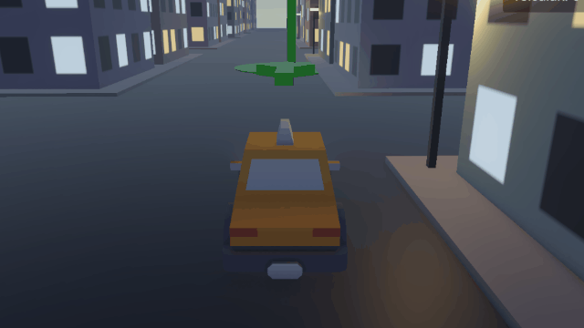
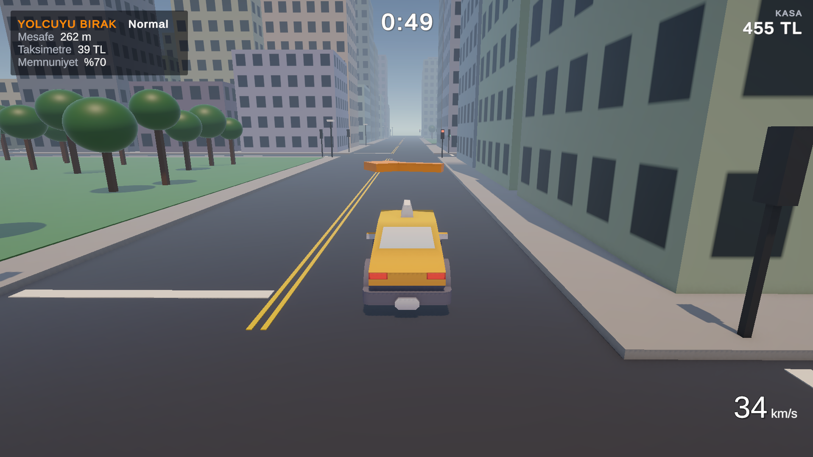
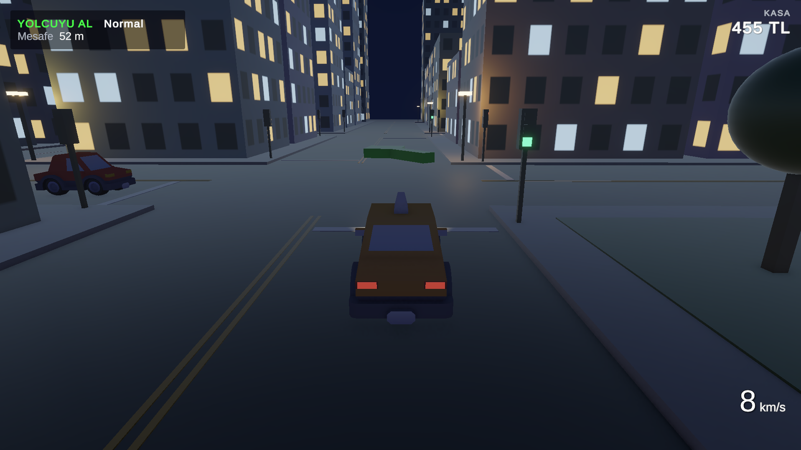

# TaxiSim

A 3D taxi driving game built in **Unity 6 (URP)**. Pick up passengers across a procedurally generated city, beat the clock, avoid traffic, and keep your passengers happy.

| Day | Night |
|---|---|
|  |  |

## Gameplay

- Find the **green marker**, stop inside it to pick up a passenger.
- Drive them to the **orange marker** before the timer runs out.
- The **taximeter** charges by distance driven and time spent waiting, like a real cab.
- Arrive on time for a **tip**. Crashes and driving on the sidewalk lower passenger satisfaction, and with it your tip.
- Arrive late and the passenger disputes the meter: they pay at most the fare of the shortest route, minus 30%. Taking the long way never pays.
- Your earnings are **saved**. Spend them in the **Garage** to upgrade the engine, brakes and tyres.

## Controls

| Key | Action |
|---|---|
| W / S | Accelerate / reverse (S brakes while moving forward) |
| A / D | Steer |
| Space | Brake |
| H | Horn |
| T (hold) | Speed up time ×20 |
| ESC / P | Pause menu |

## Features

- **Arcade vehicle physics**: force-based controller on a Rigidbody with custom lateral grip instead of WheelColliders.
- **Procedural city**: grid of blocks, sidewalks, buildings and street lamps generated at runtime from a seed.
- **Traffic AI**: cars navigate the road grid intersection by intersection, keep to the right lane, and brake for obstacles using a `BoxCast` along their *intended* path, so they also see cars while turning.
- **Passenger loop**: state machine (`enum`) for pick-up / drop-off, time limit, tips and satisfaction.
- **Day/night cycle**: animated sun, flat ambient and fog driven by time of day, headlights and street lamps that switch on at dusk, lit building windows.
- **Procedural textures**: building window patterns are drawn in code, tiled to whole floors and windows.
- **Save system**: money and upgrade levels persist between sessions (`PlayerPrefs` behind a static `SaveData` class).
- **Data-driven upgrades**: each upgrade is a `ScriptableObject` asset (name, prices per level, bonus per level, affected stat). Adding a new upgrade needs no code or UI changes; the garage builds its rows from a prefab at runtime.
- **Menus**: main menu scene and an ESC pause menu (`Time.timeScale`, audio pause, scene loading with `SceneManager`).
- **UI**: Canvas + TextMeshPro HUD with auto-sizing layout (Vertical Layout Group + Content Size Fitter).
- **Procedural audio**: engine sound synthesized in `OnAudioFilterRead` with gear shifts; optional recorded clip with pitch control. Two-tone horn.

## Technical notes

Some problems I ran into and how they were solved:

- **Car wouldn't move**: the box collider's default friction fought the force-based controller. Fixed with a frictionless Physics Material, since grip is handled in code.
- **Camera far behind the car**: `TransformPoint` applied the car's non-uniform scale to the camera offset. Replaced with `position + rotation * offset`.
- **Traffic pushed the player like a bulldozer**: kinematic bodies ignore collisions. Traffic cars now stop for a moment on contact.
- **Decoupling**: the taxi raises an `OnCrash` event; the passenger system subscribes to it. The taxi doesn't know who listens.
- **Fog and glowing windows missing in the build**: Unity stripped shader variants that were only enabled from code at runtime. Fixed by enabling fog in the scene's lighting settings and creating city materials from a template material with emission enabled, instead of `Shader.Find`.

## Project structure

| Script | Purpose |
|---|---|
| `TaxiController` | Player car physics, input, ground/sidewalk detection, crash event |
| `CameraFollow` | Smooth chase camera |
| `CityGenerator` | Procedural city, window textures, street lamps |
| `PassengerManager` | Ride loop, taximeter, timer, tips, penalties |
| `NavigationArrow` | Arrow above the taxi pointing to the current target |
| `TrafficCar` / `TrafficSpawner` | Traffic AI and spawning |
| `GameHUD` | On-screen UI |
| `DayNightCycle` | Sun, ambient, fog, sky, headlights, lamps, windows |
| `EngineSound` | Engine and horn audio |
| `Sidewalk` | Marker component for sidewalk detection |
| `MainMenu` / `PauseMenu` | Main menu, pause, return to menu, quit |
| `SaveData` | Persistent money and upgrade levels |
| `UpgradeDefinition` | ScriptableObject describing one upgrade |
| `TaxiUpgrades` | Applies purchased upgrades to the taxi |
| `GarageMenu` / `UpgradeRow` | Garage screen and its generated rows |

## Running

- **Play**: download the latest build from the Releases page and run `TaxiSim.exe` (Windows).
- **Open in Unity**: Unity 6.3 LTS (6000.3.11f1) or newer, open `Assets/Scenes/MainMenu` and press Play.

## Credits

See [CREDITS.md](CREDITS.md).
